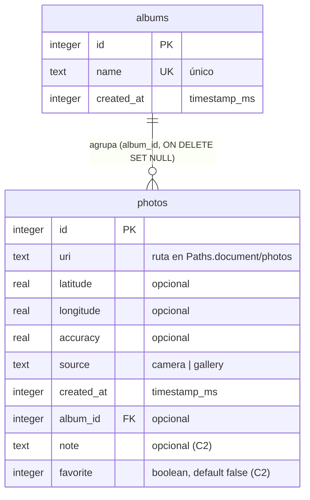

# GeoCam – Semana 7: offline-first con SQLite y Drizzle ORM

Cámara que etiqueta cada foto con coordenadas GPS, mapa de fotos, álbumes, notas, favoritas y
borrado al agitar el teléfono. Las fotos y sus datos **sobreviven al cierre de la app**: los
metadatos viven en SQLite (Drizzle ORM sobre `expo-sqlite`) y los archivos en la carpeta de
documentos de la app.

Expo SDK 57 · Expo Router · TypeScript estricto · Drizzle ORM 0.45 · probado con Expo Go.


## Ejecutar

```bash
npm install
npx expo start -c         # -c: caché limpia (necesario tras tocar Babel o Metro)
npx expo start --tunnel   # si el teléfono está en otra red
```

## Diagrama de tablas



Versión en texto:

```
albums (1) ──────────────< (0..n) photos
  id PK                           id PK
  name UNIQUE                     uri, latitude?, longitude?, accuracy?
  created_at                      source ('camera' | 'gallery'), created_at
                                  album_id? → albums.id  (al borrar el álbum queda NULL)
                                  note?, favorite (false)
```

## Migraciones

Todas generadas con `npx drizzle-kit generate` (ninguna editada a mano) y aplicadas al abrir la app
con `useMigrations` en `src/app/_layout.tsx`:

| Migración | Contenido |
|---|---|
| `0000_dark_clea` | Tabla `photos` (taller en clase) |
| `0001_albums` | Tabla `albums` + columna `photos.album_id` (C1) |
| `0002_note_favorite` | Columnas `photos.note` y `photos.favorite` (C2) |

Las migraciones 0001 y 0002 usan `ALTER TABLE ... ADD`, así que las fotos tomadas antes se conservan.

> **Nota sobre `ON DELETE SET NULL`:** drizzle-kit genera `ADD album_id ... REFERENCES albums(id)`
> sin la acción `ON DELETE` (al añadir una columna con `ALTER TABLE` en SQLite). Por eso
> `albumsRepo.remove` deja primero las fotos sin álbum y luego borra el álbum, en una sola
> transacción. Detalle en el [AI-LOG](AI-LOG.md).

## Arquitectura por capas

Cada capa habla solo con la siguiente; las pantallas no importan nada de Drizzle.

```
src/app/                         Pantallas
  _layout.tsx                    Stack + useMigrations (ninguna pantalla se monta sin migrar)
  (tabs)/geocam.tsx              Cámara, galería, banner de ubicación
  (tabs)/mapa.tsx                Marcadores y lista "Sin ubicación"
  (tabs)/fotos.tsx               Buscador por nota, filtros por álbum y favoritas, crear/borrar álbumes
  foto/[id].tsx                  Detalle: nota, favorita, mover de álbum, eliminar
src/hooks/                       Hooks: unen consultas reactivas (useLiveQuery) con acciones
  usePhotos.ts                   photos, photosWithLocation, addPhoto, removePhoto, clearAll
  usePhotoFilters.ts             Lista filtrada; se recalcula al cambiar búsqueda, álbum o favoritas
  usePhoto.ts                    Una foto por id + setNote, toggleFavorite, moveToAlbum, remove
  useAlbums.ts                   albums, addAlbum, removeAlbum
src/db/repositories/             Única capa que conoce Drizzle
  photos.ts                      listQuery, withLocationQuery, filteredQuery, byIdQuery, findById,
                                 create, update, remove, clearAll, listUris
  albums.ts                      listQuery, create, remove
src/db/schema.ts, client.ts      Esquema type-safe y conexión (enableChangeListener + foreign_keys)
src/services/photoFiles.ts       Copia caché → Paths.document/photos y borra archivos (API File/Directory/Paths)
drizzle/                         Migraciones SQL versionadas + migrations.js
```

## Requisitos de la semana

| Tarea | Dónde |
|---|---|
| T1 Configuración | `drizzle.config.ts` (`driver: 'expo'`), `babel.config.js` (`inline-import`), `metro.config.js` (`sql`) |
| T2 Cliente y migraciones | `src/db/client.ts`, `useMigrations` en `src/app/_layout.tsx` |
| T3 Repositorio | `src/db/repositories/photos.ts` (`withLocationQuery` usa `isNotNull`) |
| T4 Hook usePhotos | `src/hooks/usePhotos.ts` (`coords` → columnas planas) |
| T5 Integración | GeoCam, Mapa y `ShakeToClear` usan `usePhotos` (sin Context) |
| C1 Álbumes | `albums` + `photos.albumId` con `onDelete: 'set null'` |
| C2 Segunda migración | `note` y `favorite` (`0002_note_favorite`) |
| C3 CRUD completo | `src/app/foto/[id].tsx` |
| C4 Búsqueda y filtros | `src/app/(tabs)/fotos.tsx` + `usePhotoFilters` (`like`, álbum, favoritas) |
| C5 Archivos permanentes | `src/services/photoFiles.ts`, usado en `addPhoto` / `removePhoto` / `clearAll` |
| C6 Documentación | Este README y [`AI-LOG.md`](AI-LOG.md) |

## Verificación automática

```bash
npx tsc --noEmit   # tipos
npx expo lint      # lint (incluye reglas del React Compiler)
npm test           # 31 pruebas de los hooks de cámara, ubicación y agitado
```

## Pruebas en el teléfono

- [ ] Tomar tres fotos, cerrar Expo Go por completo, abrir de nuevo: las fotos y los marcadores del mapa siguen ahí.
- [ ] Con fotos de la clase ya guardadas, abrir la nueva versión: las migraciones se aplican y las fotos se conservan.
- [ ] Modo avión: cámara, fotos, álbumes y filtros funcionan igual (solo el fondo del mapa necesita red).
- [ ] Fotos → crear un álbum; en el detalle de una foto, moverla al álbum, escribir una nota y marcarla favorita.
- [ ] Buscar por una palabra de la nota y filtrar por álbum y "Solo favoritas": la lista se actualiza sola.
- [ ] Mantener presionado el álbum y eliminarlo: sus fotos siguen en "Todos", sin álbum.
- [ ] Eliminar una foto desde el detalle: desaparece de la lista, del mapa y su archivo se borra.
- [ ] Agitar el teléfono y confirmar: se borran todas las fotos y sus archivos.

## Mapa

Con el SDK 57, Expo Go en Android no dibuja las teselas de Google Maps ([expo/expo#49323][1]),
así que `src/app/(tabs)/mapa.tsx` muestra un mapa de Leaflet + OpenStreetMap dentro de un `WebView`.
Los marcadores salen de SQLite y funcionan sin red, pero el **fondo del mapa (teselas) necesita
internet**: en modo avión los marcadores y la lista siguen ahí, aunque sin el mapa de fondo.

[1]: https://github.com/expo/expo/issues/49323
