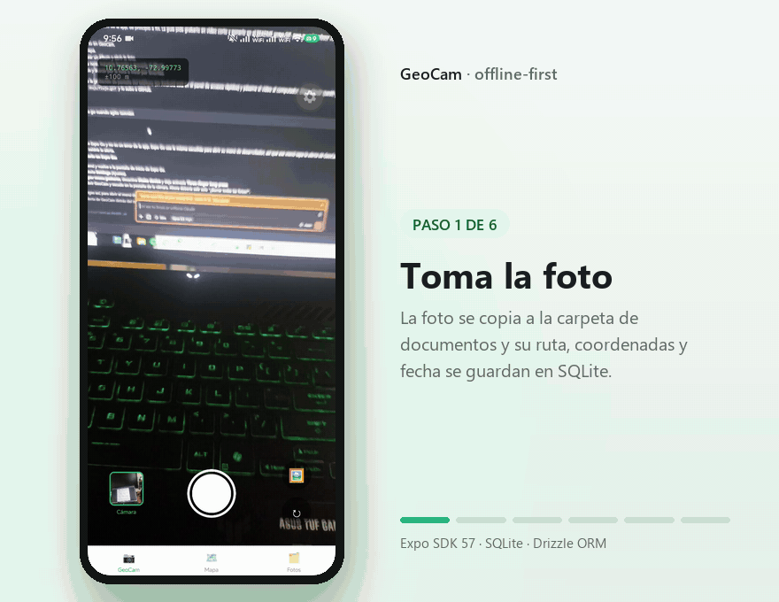
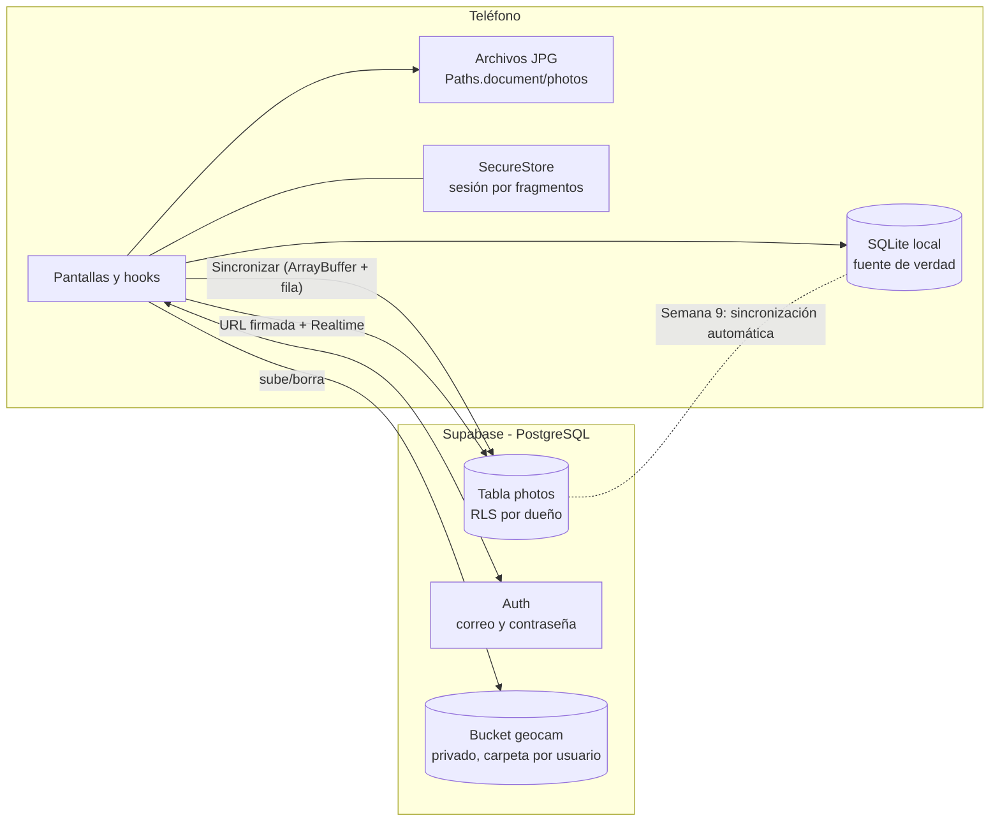
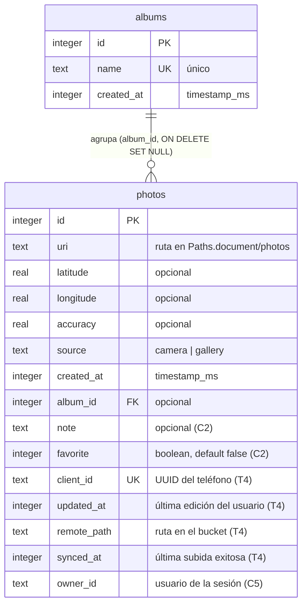

# GeoCam – Semana 8: backend en la nube con Supabase

Cámara que etiqueta cada foto con coordenadas GPS, mapa de fotos, álbumes, notas, favoritas y
borrado al agitar el teléfono. Las fotos y sus datos **sobreviven al cierre de la app** y ahora
también **al cambio de teléfono**: los metadatos viven en SQLite local (Drizzle ORM sobre
`expo-sqlite`), los archivos en la carpeta de documentos, y la nube (Supabase) guarda la copia de
respaldo con autenticación, RLS y bucket privado.

Expo SDK 57 · Expo Router · TypeScript estricto · Drizzle ORM 0.45 · Supabase (Auth, PostgreSQL,
Storage, Realtime) · probado con Expo Go.



> El GIF del flujo en la nube (subir, sincronizar, ver la pestaña Nube en otro teléfono) se graba
> en el teléfono al hacer las pruebas de abajo; por ahora queda el flujo local de la Semana 7.

## Configurar Supabase (una vez)

1. Crea un proyecto en <https://supabase.com/dashboard> (New project). Guarda la contraseña de la
   base de datos en un lugar seguro: **nunca va en el código**.
2. En **Authentication → Providers → Email**, desactiva la confirmación por correo mientras se
   prueba (en una app real se deja activa).
3. En **SQL Editor** pega y ejecuta el archivo completo [`docs/sql/semana8-geocam.sql`](docs/sql/semana8-geocam.sql)
   (tabla `photos` remota con RLS, bucket privado `geocam` y sus políticas).
4. Copia la **Project URL** y la **publishable key** (`sb_publishable_...`) desde
   *Project Settings → API Keys*.
5. Pega ambas en `.env` (está en `.gitignore`; existe `.env.example` con los nombres sin valores):

   ```bash
   EXPO_PUBLIC_SUPABASE_URL=https://xxxxxxxx.supabase.co
   EXPO_PUBLIC_SUPABASE_PUBLISHABLE_KEY=sb_publishable_xxxxxxxx
   ```

6. Arranca con caché limpia: `npx expo start -c` (las variables `EXPO_PUBLIC_` se leen al
   empaquetar).

```bash
npm install
npx expo start -c         # -c: caché limpia (necesario tras tocar .env, Babel o Metro)
npx expo start --tunnel   # si el teléfono está en otra red
```

## Diagrama de las dos bases



SQLite responde siempre (modo avión); la nube es el respaldo y el punto de encuentro entre
dispositivos. La sincronización automática bidireccional llega en la Semana 9.

## Esquemas

### Local (SQLite, Drizzle)



### Remoto (PostgreSQL, ver SQL completo en `docs/sql/semana8-geocam.sql`)

```
photos remota (Supabase)                     storage.objects (bucket geocam, privado)
  id bigint PK                                ruta: <auth.uid>/<client_id>.jpg
  user_id uuid → auth.users (default auth.uid())
  client_id uuid UNIQUE  ← mismo valor local   Políticas (todas a authenticated):
  storage_path text UNIQUE                    insert/select/update/delete solo en la
  latitude, longitude, note, favorite           carpeta del propio usuario
  source ('camera'|'gallery')                 Publicación supabase_realtime: photos
  taken_at, updated_at, created_at
  RLS: select/insert/update/delete solo cuando auth.uid() = user_id
```

Editar una foto local escribe `updatedAt`; una foto está **pendiente** cuando `syncedAt` es nulo o
anterior a `updatedAt`, y la subida (upsert por `client_id` y por ruta fija) la reemplaza sin crear
duplicados.

## Migraciones

Todas generadas con `npm run db:generate` (`drizzle-kit generate`; ninguna editada a mano) y
aplicadas al abrir la app con `useMigrations` en `src/app/_layout.tsx`:

| Migración | Contenido |
|---|---|
| `0000_dark_clea` | Tabla `photos` (Semana 7) |
| `0001_albums` | Tabla `albums` + columna `photos.album_id` (S7 C1) |
| `0002_note_favorite` | Columnas `photos.note` y `photos.favorite` (S7 C2) |
| `0003_sync_fields` | `client_id`, `updated_at`, `remote_path`, `synced_at` (T4) |
| `0004_owner_id` | `owner_id` (C5) |

Al arrancar, `ensureSyncFields()` rellena una sola vez `client_id` y `updated_at` de las fotos de la
Semana 7, y `claimOrphans()` le da el dueño actual a las fotos que no tenían.

> **Nota sobre `clientId`:** la guía lo declara con `$defaultFn(() => Crypto.randomUUID())` en el
> esquema, pero `drizzle-kit generate` falla si el esquema importa `expo-crypto`
> (bug drizzle-team/drizzle-orm#4961). El UUID se genera en `photosRepo.create` y en
> `ensureSyncFields`; el esquema no importa módulos nativos.

## Arquitectura por capas

Cada capa habla solo con la siguiente; las pantallas no importan nada de Drizzle ni de Supabase
directamente (los servicios sí, y son la única puerta).

```
src/app/                         Pantallas
  _layout.tsx                    useMigrations → ensureSyncFields → AuthProvider → Stack.Protected
  index.tsx                      Fuera de los grupos: redirige a /geocam o /login según la sesión
  login.tsx                      Registro e inicio con correo y contraseña
  (tabs)/geocam.tsx              Cámara, galería, banner de ubicación
  (tabs)/mapa.tsx                Marcadores y lista "Sin ubicación"
  (tabs)/fotos.tsx               Cerrar sesión, Sincronizar (avance "3 de 7"), buscador, álbumes, ☁
  (tabs)/nube.tsx                Fotos del usuario en Supabase con URL firmada y Realtime (C4)
  foto/[id].tsx                  Detalle: nota, favorita, álbum, "Subir a la nube", eliminar
src/context/AuthContext.tsx      Sesión de Supabase + claimOrphans de las fotos sin dueño
src/lib/
  supabase.ts                    createClient con storage seguro y auto-refresh por AppState
  secureStorage.ts               Sesión de Supabase en SecureStore por fragmentos de 1000 bytes
src/hooks/
  usePhotos.ts / usePhoto.ts / usePhotoFilters.ts   Consultas reactivas filtradas por owner_id
  useSync.ts                     Botón Sincronizar: avance, resumen y pendientes restantes
  useCloudPhotos.ts              Fotos remotas + URL firmadas + recarga por Realtime
  useAlbums.ts, useCamera.ts, useGeoLocation.ts, useShake.ts
src/services/
  photoFiles.ts                  Copia caché → Paths.document/photos y borra archivos
  cloudPhotos.ts                 Única puerta a Supabase: uploadPhoto, syncPendingPhotos,
                                 deletePhotoCoherent, listCloudPhotos, signedUrl
src/db/repositories/photos.ts    Única capa que conoce Drizzle; filtra siempre por owner_id
src/db/schema.ts, client.ts      Esquema type-safe y conexión (enableChangeListener + foreign_keys)
drizzle/                         Migraciones SQL versionadas + migrations.js
docs/sql/semana8-geocam.sql      SQL completo para el panel de Supabase
```

## Requisitos de la semana

| Tarea | Dónde |
|---|---|
| T1 Cliente y credenciales | `lib/supabase.ts`, `lib/secureStorage.ts`, `.env` (ignorado) + `.env.example` |
| T2 Autenticación | `context/AuthContext.tsx`, `app/login.tsx`, `Stack.Protected` en `_layout.tsx`, cerrar sesión en Fotos |
| T3 Backend | `docs/sql/semana8-geocam.sql` (tabla + RLS + bucket privado) |
| T4 Migración local | `0003_sync_fields` + `ensureSyncFields()` en `photosRepo` |
| T5 Subida | `services/cloudPhotos.ts`, botón en `foto/[id].tsx`, ícono ☁ en miniaturas |
| T6 Verificación | Subir una foto y encontrarla en el panel dentro de tu carpeta; cerrar la app: la sesión sigue |
| C1 Pendientes | Botón "Sincronizar" con avance ("Subiendo 3 de 7…") y resumen de pendientes |
| C2 Sin duplicados ni huérfanos | Ruta fija por `client_id` + upsert; si la fila falla se borra el archivo subido |
| C3 Borrado coherente | `deletePhotoCoherent`: nube primero, teléfono después; sin conexión no se borra nada a medias |
| C4 Pestaña Nube | `(tabs)/nube.tsx` + `useCloudPhotos` (URL firmada, Realtime, pull-to-refresh) |
| C5 Datos por usuario | `0004_owner_id`; todas las consultas de fotos se filtran por la sesión |
| C6 Auditoría | Ver abajo: `.env` nunca entró al historial, `.env.example` existe, sin secret keys |
| C7 Documentación | Este README, `docs/sql/semana8-geocam.sql` y [`AI-LOG.md`](AI-LOG.md) |

## Seguridad

- **Publishable key sí, secret key no.** La llave dentro de la app es pública: lo que la limita son
  las políticas RLS. La secret key (`sb_secret_...`) y la contraseña de la base de datos viven solo
  en el panel.
- **La sesión se guarda cifrada** en SecureStore (Keychain/Keystore), por fragmentos de 1000 bytes;
  AsyncStorage dejaría el refresh token en texto plano.
- **RLS activo** en la tabla y en el bucket: una segunda cuenta no ve ni borra fotos ajenas, ni
  siquiera con la URL del proyecto.
- **Si una llave llega a GitHub**, borrarla en un commit posterior no sirve: rótala en el panel.

## Auditoría de credenciales (C6)

```bash
git log --all --full-history -- .env    # vacío: .env nunca entró al historial
git status --short | grep '\.env'       # solo aparece .env.example
git grep -nE 'sb_secret|service_role'   # sin resultados en el código
ls .env .env.example                    # .env local ignorado, .env.example versionado
```

## Verificación automática

```bash
npx tsc --noEmit   # tipos
npx expo lint      # lint (incluye reglas del React Compiler)
npm test           # 31 pruebas de los hooks de cámara, ubicación y agitado
```

## Pruebas en el teléfono

- [ ] Registrar una cuenta nueva: entra directo a GeoCam; sin sesión no existe ninguna pantalla privada.
- [ ] Cerrar la app por completo y abrirla: la sesión sigue iniciada (SecureStore).
- [ ] Tomar una foto y tocar "Subir a la nube": aparece en el panel de Supabase dentro de
      `geocam/<tu user id>/<client_id>.jpg` y con su fila en `photos`.
- [ ] Tocar "Sincronizar" con varias fotos pendientes: el botón muestra "Subiendo X de Y…" y el
      resumen final; repetirlo no crea duplicados (misma ruta, mismo `client_id`).
- [ ] Editar la nota de una foto ya subida: queda pendiente; "Actualizar en la nube" reemplaza la copia.
- [ ] Pestaña Nube: se ven las fotos con imagen; al subir desde otro dispositivo aparecen solas (Realtime).
- [ ] Con una segunda cuenta, iniciar sesión: no ve las fotos de la primera (RLS + ownerId local).
- [ ] Borrar una foto sincronizada con señal: desaparece de Nube y del bucket; en modo avión la app
      avisa y no borra nada a medias.
- [ ] Fotos → crear un álbum, mover fotos, favoritas, buscar por nota (siguen funcionando igual).
- [ ] Agitar el teléfono y confirmar: borra todo, incluidas las copias de la nube (con señal).
- [ ] Grabar un GIF del flujo en la nube y agregarlo aquí (C7).

## Mapa

Con el SDK 57, Expo Go en Android no dibuja las teselas de Google Maps ([expo/expo#49323][1]),
así que `src/app/(tabs)/mapa.tsx` muestra un mapa de Leaflet + OpenStreetMap dentro de un `WebView`.
Los marcadores salen de SQLite y funcionan sin red, pero el **fondo del mapa (teselas) necesita
internet**: en modo avión los marcadores y la lista siguen ahí, aunque sin el mapa de fondo.

[1]: https://github.com/expo/expo/issues/49323
