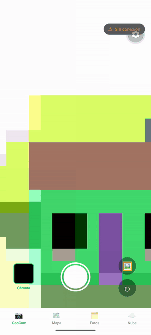
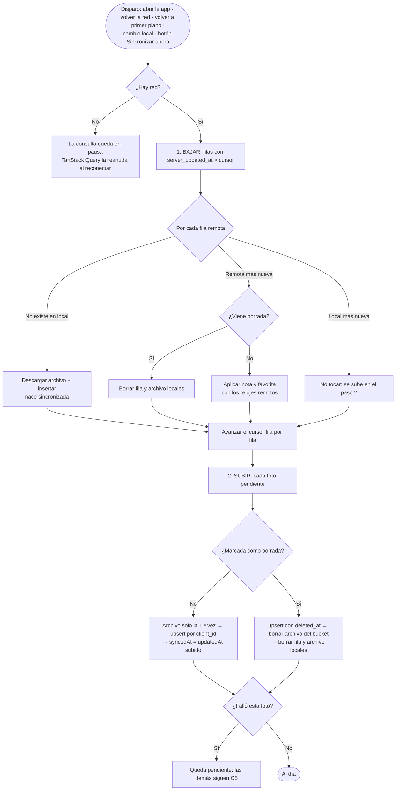

# GeoCam – Semana 9: sincronización offline-first con TanStack Query

Cámara que etiqueta cada foto con coordenadas GPS, mapa, álbumes, notas y favoritas. La app
**funciona completa sin conexión**: todo se lee y se escribe en SQLite. Cuando vuelve la red,
**sube sola lo pendiente y baja lo que se creó, editó o borró en otro teléfono** con la misma
cuenta. La pestaña Nube muestra lo que hay en Supabase con un feed paginado que también se ve sin
conexión.

Expo SDK 57 · Expo Router · TypeScript estricto · Drizzle ORM 0.45 · Supabase (Auth, PostgreSQL,
Storage, Realtime) · TanStack Query 5 · expo-network.



> Grabación real en el emulador de Android con un Supabase local, acelerada 1,5×. Las miniaturas
> negras son de la cámara virtual del emulador, que captura en negro.

> Entregas anteriores: [Semana 8](README-semana-8.md) (Supabase) · los AI-LOG de las semanas
> 6, 7 y 8 están en [`docs/`](./).

## Cómo ejecutarlo

1. **Supabase** (una vez). En el SQL Editor ejecuta, en orden:
   [`docs/sql/semana8-geocam.sql`](sql/semana8-geocam.sql) (si el proyecto es nuevo) y
   [`docs/sql/semana9-geocam.sql`](sql/semana9-geocam.sql).
2. **Credenciales.** Copia `.env.example` como `.env` con la URL del proyecto y la publishable key.
3. **Instalar y correr:**

   ```bash
   npm install
   npx expo start -c   # -c: caché limpia (tras tocar .env, Babel o Metro)
   ```

Las migraciones locales se aplican solas al abrir la app (`useMigrations`).

## Diseño de la sincronización

1. **SQLite es la fuente de verdad.** La UI nunca espera a la nube.
2. **Identidad compartida:** cada foto tiene un `clientId` (UUID creado en el teléfono).
3. **Pendiente** = `syncedAt` vacío o anterior a `updatedAt`.
4. **Cursor de bajada** por usuario, guardado en la tabla local `sync_meta`.
5. **Conflictos:** gana el último cambio (`updatedAt` más reciente). **Un borrado es un cambio más.**



| Columna remota | Quién la escribe | Para qué sirve |
| --- | --- | --- |
| `updated_at` | El teléfono, con la hora de la edición | Decidir quién gana un conflicto |
| `server_updated_at` | PostgreSQL (trigger) | Cursor de bajada: "lo que llegó después de X" |
| `deleted_at` | El teléfono que borró | Que los demás teléfonos se enteren del borrado (C1) |

**Por qué se baja primero:** si se subiera primero, un cambio local viejo pisaría en la nube un
cambio más nuevo de otro teléfono antes de compararlos.

**Por qué dos relojes:** una foto editada sin conexión el lunes y subida el miércoles tiene
`updated_at` de lunes. Si el cursor usara esa columna, un teléfono que sincronizó el martes nunca
la bajaría. `server_updated_at` dice cuándo *llegó* al servidor.

**Por qué es seguro reintentar:** la subida es idempotente. El archivo va siempre a
`<usuario>/<clientId>.jpg` ("ya existe" no es error) y la fila se guarda con upsert por
`client_id`. Hacerlo una vez o diez deja el mismo resultado.

**Por qué no hay `DELETE` directo:** una fila borrada no deja rastro que bajar; los demás teléfonos
nunca se enterarían. Por eso borrar es **marcar** (`deletedAt`). La marca se sube, los demás la
aplican, y solo entonces se eliminan el archivo del bucket y la fila local.

### La regla de conflicto con un ejemplo

| Hora | Teléfono A (modo avión) | Teléfono B (modo avión) |
| --- | --- | --- |
| 10:00 | Foto sincronizada, nota "Playa" | La misma foto, nota "Playa" |
| 10:05 | Cambia la nota a "Playa de Riohacha" | — |
| 10:06 | — | Cambia la nota a "Atardecer" |
| 10:10 | Reconecta: baja (nada nuevo) y sube "Playa de Riohacha" (`updated_at` 10:05) | — |
| 10:11 | — | Reconecta: baja la de A, pero 10:05 < 10:06 → la local gana y sube "Atardecer" |
| 10:12 | Siguiente ciclo: baja "Atardecer" (10:06 > 10:05) y la aplica | — |

En los dos queda **"Atardecer"**, la edición más reciente. Si B hubiera **borrado** la foto a las
10:06, el borrado sería el último cambio y la foto desaparecería en los dos. Si en cambio A editara
*después* del borrado, gana la edición y la foto vuelve, con el archivo subido de nuevo.

La regla pierde la edición más antigua (aceptable para notas personales, no para un saldo) y
depende de que la hora de los teléfonos sea razonable.

### Qué hace TanStack Query y qué es diseño propio

| TanStack Query (`hooks/useSync.ts`, `lib/queryClient.ts`) | Diseño propio (`services/sync.ts`) |
| --- | --- |
| Ejecutar el ciclo al iniciar sesión (`enabled`) | Qué se sube y qué se baja |
| Pausarlo sin red y reanudarlo al reconectar (`onlineManager` + expo-network) | El orden: bajar y luego subir |
| Repetirlo al volver a primer plano (`focusManager` + AppState) | La regla de conflicto (`remoteWins`, función pura) |
| Reintentar si falla (`retry: 2`) | Idempotencia (ruta fija + upsert por `client_id`) |
| Pedirlo tras cada cambio local (`invalidateQueries(['sync'])`) | Borrado lógico y errores por foto |

## Esquemas

**Local (SQLite):** `photos` (con `client_id`, `updated_at`, `remote_path`, `synced_at`,
`owner_id`, `deleted_at`), `albums` y `sync_meta` (`key` PK, `value`: cursor de bajada y último
resultado).

**Remoto (Supabase):** `photos` con `client_id` único, `updated_at`, `server_updated_at` (trigger),
`deleted_at`, RLS por dueño; bucket privado `geocam` con una carpeta por usuario.

| Migración local | Contenido |
| --- | --- |
| `0000`–`0002` | Fotos, álbumes, nota y favorita (Semana 7) |
| `0003_sync_fields`, `0004_owner_id` | Campos de sincronización y dueño (Semana 8) |
| `0005_sync_meta` | Tabla `sync_meta` (T3) |
| `0006_deleted_at` | Columna `deleted_at` para el borrado lógico (C1) |

Todas generadas con `npx drizzle-kit generate`, ninguna editada a mano.

## Arquitectura por capas

Las pantallas no importan Supabase ni Drizzle: hablan con hooks; los hooks con repositorios y
servicios; solo `services/` conoce Supabase y solo `db/repositories/` conoce Drizzle.

```
src/app/
  _layout.tsx               useMigrations → PersistQueryClientProvider → AuthProvider → Stack
  (tabs)/geocam.tsx         Cámara + indicador de sincronización
  (tabs)/fotos.tsx          Lista local, filtros, álbumes + indicador
  (tabs)/nube.tsx           Feed de la nube: infinite scroll, búsqueda, 4 estados (C2)
  sincronizacion.tsx        Estado de sincronización y "Sincronizar ahora" (C4)
  foto/[id].tsx             Detalle: nota, favorita, álbum, eliminar (borrado lógico)
src/components/SyncBadge.tsx  Sin conexión · N pendientes · Sincronizando · Al día (T6)
src/hooks/
  useSync.ts                La sincronización como useQuery + requestSync() (T6)
  useCloudFeed.ts           useInfiniteQuery del feed + Realtime que invalida la caché (C2)
  useDebouncedValue.ts      Búsqueda en vivo sin una petición por tecla
  usePhotos.ts, usePhoto.ts Cada cambio local pide sincronizar; borrar = marcar
src/lib/queryClient.ts      QueryClient, onlineManager, focusManager, persistencia (T2, C3)
src/services/
  sync.ts                   pull, push, syncAll, remoteWins (T4, T5, C1, C5)
  cloudPhotos.ts            Única puerta a Supabase para fotos y feed paginado
  photoFiles.ts             Copiar, descargar (URL firmada) y borrar archivos
src/db/repositories/        photos.ts (pendingQuery, findByClientId, insertFromRemote,
                            applyRemote, markSynced, markDeleted…) y syncMeta.ts (T3)
docs/sql/semana9-geocam.sql T1 + C1 para el panel de Supabase
```

## Requisitos de la semana

| Tarea | Dónde |
| --- | --- |
| T1 Backend | `docs/sql/semana9-geocam.sql`: `server_updated_at` + trigger + índice. La política de update ya existía desde la Semana 8 |
| T2 TanStack Query | `lib/queryClient.ts` y el proveedor en `app/_layout.tsx` |
| T3 Soporte local | `0005_sync_meta`, `db/repositories/syncMeta.ts` y los métodos nuevos de `photosRepo` |
| T4 Bajar | `pull` en `services/sync.ts` con cursor en `sync_meta` y `remoteWins` |
| T5 Subir | `push`: archivo si falta, upsert por `client_id`, `markSynced` con el `updatedAt` subido |
| T6 Disparo y estado | `hooks/useSync.ts` + `components/SyncBadge.tsx` en GeoCam y Fotos |
| T7 Verificación | Matriz de abajo |
| C1 Borrados sincronizados | `deletedAt` local + `deleted_at` remoto; la UI filtra las marcadas; archivos fuera al sincronizar la marca |
| C2 Feed de la nube | `(tabs)/nube.tsx` + `useCloudFeed`: cursor por `taken_at`, infinite scroll, búsqueda con espera, carga / error con reintento / vacío / sin conexión |
| C3 Caché que sobrevive al cierre | `PersistQueryClientProvider` con `expo-sqlite/kv-store`; solo se persiste el feed (`['cloud', …]`) |
| C4 Pantalla de estado | `app/sincronizacion.tsx`: pendientes, fecha, subidas/bajadas, último error, botón |
| C5 Errores por foto | `push` con `try/catch` por foto; la que falla queda pendiente |
| C6 Matriz de pruebas | Abajo |
| C7 Documentación | Este README, el GIF y [`AI-LOG.md`](AI-LOG-semana-9.md) |

## Matriz de pruebas (C6)

La matriz se ejecutó de dos formas, y cada columna dice lo que realmente se observó:

- **Simulación:** resultado de `npm test`. El archivo
  [`src/__tests__/sync.test.ts`](../src/__tests__/sync.test.ts) ejecuta el `services/sync.ts` real
  contra dos teléfonos y una nube simulados en memoria.
- **Emulador:** la app real en Expo Go (Android 15) contra un Supabase local en Docker con los SQL
  de este repositorio. Hay un solo emulador, así que el "teléfono B" es un script con `supabase-js`
  que entra con la misma cuenta y hace las mismas escrituras. Los resultados se comprobaron en la
  pantalla y consultando la base y el bucket.

Falta repetirla con dos teléfonos físicos contra el proyecto real de Supabase.

| # | Escenario | Resultado esperado | Simulación | Emulador |
| --- | --- | --- | --- | --- |
| 1 | Foto tomada sin conexión; luego se reconecta | Se sube sola; pendientes vuelve a 0 | ✅ Sin red el ciclo falla y queda 1 pendiente; al reconectar sube fila y archivo, 0 pendientes | ✅ 0 filas en modo avión; al reconectar, sin tocar nada, 2 filas y 2 archivos de ~19 KB con la nota editada, y "Al día" |
| 2 | Foto creada en el teléfono A | Aparece en B con imagen y ubicación | ✅ B la descarga a `photos/<clientId>.jpg` con lat/lng y nace sincronizada | ✅ La foto de B llegó al volver a primer plano, con imagen, nota y coordenadas en el detalle, y su marcador en el mapa abre la miniatura |
| 3 | Nota editada en A y después en B, ambos sin conexión | En los dos queda la nota de B | ✅ Queda la de B en A, en B y en la nube, en los dos órdenes de reconexión | ✅ En los dos sentidos: con B posterior quedó la nota de B; con A posterior quedó la de A y subió a la nube |
| 4 | Foto borrada en A | Desaparece en B y del bucket | ✅ La UI de A la oculta al instante; la fila remota queda con `deleted_at`, el archivo sale del bucket y B la borra con su archivo | ✅ Borrada en modo avión: se oculta al instante; al reconectar, `deleted_at` en la fila y 0 archivos en el bucket. El borrado hecho en B también llegó aquí |
| 5 | Foto editada en A y borrada después en B, ambos sin conexión | Queda borrada en los dos | ✅ Borrada en A, B, la nube y el bucket, en los dos órdenes. Caso inverso (editada después del borrado): gana la edición y el archivo se vuelve a subir | ✅ Editada aquí sin conexión y borrada después en B: desapareció aquí, con `deleted_at` y sin archivo en el bucket |
| 6 | Se corta la red a mitad de una sincronización de 5 fotos | Al reconectar termina sin duplicar filas ni archivos | ✅ Suben 2, fallan 3 y quedan pendientes; al reconectar (y repetir) quedan 5 filas y 5 archivos | ✅ Un proxy cortó la red al llegar el tercer upsert: 2 filas y el archivo de la tercera sin su fila, "3 pendientes". Al reconectar: 5 filas y 5 archivos, sin duplicados (se toleró el "ya existe" real de Supabase) |
| 7 | Se cierra la app con fotos pendientes y se abre con red | Se sincroniza al abrir | No aplica: lo hace TanStack Query al montar `useSync` (`enabled: !!userId`) | ✅ Foto en modo avión, app cerrada a la fuerza, red de vuelta y app abierta: 0 → 1 fila sin tocar nada |

También se prueban:
- **C5:** si una foto falla, las otras dos suben y el error queda guardado para la pantalla de estado.
- **Concurrencia:** tres llamadas simultáneas y una repetida no duplican nada.
- **Borrado local:** una foto borrada que nunca llegó a la nube se elimina sin tocar Supabase.
- **Funciones puras:** las de `remoteWins` e `isPending`.

Para confirmar que la matriz detecta errores reales, se introdujeron a propósito dos errores
típicos de la IA que señala la guía:
- **Subir antes de bajar:** fallan 4 pruebas.
- **`syncedAt = new Date()` al subir:** fallan 2 pruebas.

Con el código correcto pasan todas.

En el emulador también se comprobó:
- **C2:** páginas de 10 con cursor (`limit=10` y luego `taken_at=lt.…`), búsqueda con una sola
  petición, y los estados de carga, vacío, error con "Reintentar" y sin conexión.
- **C3:** el feed guardado aparece al abrir la app en modo avión, incluso si el último refresco falló.
- **C4:** la pantalla de estado con pendientes, fecha, subidas, bajadas y "Sincronizar ahora".

```bash
npx tsc --noEmit   # tipos
npx expo lint      # lint (incluye reglas del React Compiler)
npm test           # 47 pruebas: 16 de sincronización + 31 de cámara, ubicación y agitado
```

## Pruebas pendientes en dos teléfonos físicos

- [ ] **Sin conexión:** modo avión, tomar dos fotos y editar una nota. El indicador muestra
      "Sin conexión · 3 pendientes". Quitar el modo avión: suben solas y pasa a "Al día".
- [ ] **Dos teléfonos:** misma cuenta en el teléfono de la pareja. Las fotos del primero aparecen
      con imagen y ubicación en el mapa.
- [ ] **Conflicto:** ambos en modo avión, editar la nota de la misma foto, primero en A y un minuto
      después en B. Reconectar los dos: queda la nota de B.
- [ ] **Borrado:** borrar en A; en B desaparece y en el panel de Supabase el archivo ya no está en el
      bucket (la fila queda con `deleted_at`).
- [ ] **Nube sin conexión:** abrir la pestaña Nube con red, cerrar la app, activar modo avión y
      abrir: se ve el feed guardado con el aviso "Sin conexión".
- [ ] **Feed:** con más de 10 fotos en la nube, bajar en la lista carga de a 10; la búsqueda solo
      pide al dejar de escribir.

## Mapa

Con el SDK 57, Expo Go en Android no dibuja las teselas de Google Maps ([expo/expo#49323][1]), así
que `(tabs)/mapa.tsx` usa Leaflet + OpenStreetMap en un `WebView`. Los marcadores salen de SQLite y
funcionan sin red; el fondo del mapa necesita internet.

[1]: https://github.com/expo/expo/issues/49323
